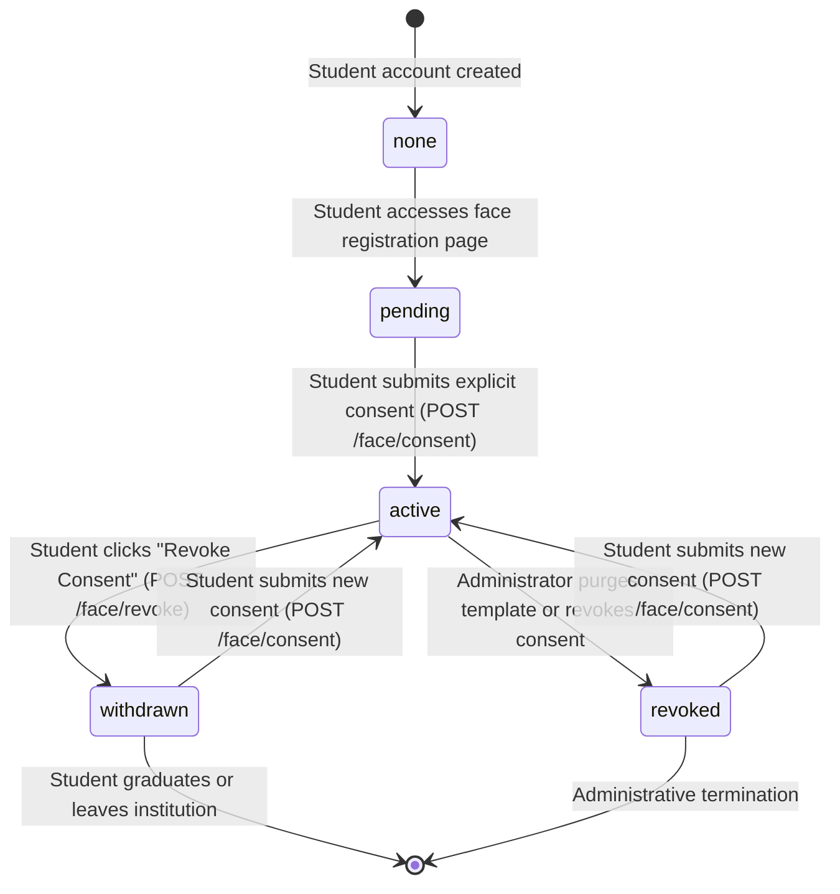

# Smart Attendance Biometric Consent Lifecycle & Governance Specification
## Project: CampusSphere AI — Smart Campus Management ERP

**Document Version:** 1.0.0  
**Phase:** Part 9 of 24 — Biometric Enrollment, Consent Management & Student Face Registration Reliability  
**Date:** November 1, 2026  
**Author:** Senior Biometric Security Engineer & Data Protection Specialist  

---

## 1. Governance Principles & Ethical Framework

Biometric facial data constitutes sensitive personal information. CampusSphere AI adheres to strict data privacy principles for educational institutions:

1. **Lawfulness & Specificity:** Biometric data is processed solely for verifying physical attendance during scheduled academic sessions.
2. **Explicit, Informed, Unbundled Consent:** Consent must be actively given via an explicit affirmative action (no pre-selected checkboxes, no bundled agreements).
3. **Data Minimization & Storage Limitation:** No raw photographs or video frames are stored on disk or database. Only irreversible, encrypted 128-dimensional facial embedding vectors are retained.
4. **Right to Withdraw Without Penalty:** Students possess the unconditional right to withdraw biometric consent at any time. Non-biometric fallback attendance mechanisms (faculty manual check-in or approved RFID) must remain accessible.
5. **Separation of Academic Records:** Revoking biometric consent terminates future facial verification but does not invalidate or erase legitimate academic attendance history.

---

## 2. Mandatory Purpose Disclosures

Prior to enrollment, students are presented with the following standardized disclosures in the UI:

| Disclosure Element | Specification |
|---|---|
| **Specific Purpose** | Facial biometric verification during active classroom attendance sessions. Not used for tracking, behavioral analytics, or campus surveillance. |
| **Data Extracted** | Mathematical representation consisting of 128 floating-point numbers (embedding vector) representing facial geometry. |
| **Raw Image Policy** | Raw camera frames are processed in-memory for $<200\text{ms}$ and permanently discarded. No images are saved to disk or persistent storage. |
| **Security & Encryption** | Templates are encrypted using AES-256-GCM with unique 12-byte initialization nonces and 16-byte authentication tags. |
| **Right of Revocation** | Consent can be withdrawn at any time via the Student Portal. Revocation immediately wipes the stored cryptographic template. |
| **Alternative Attendance** | Institutional policy governs alternative attendance verification mechanisms (such as manual faculty roster roll-call) for students who decline or withdraw consent. |
| **Retention Policy** | Active for the duration of student registration; subject to institutional graduation purge schedules or explicit student withdrawal. |

---

## 3. Consent State Machine & Transitions

The consent lifecycle is governed by the `ConsentRecord` and mirrored in `FaceEmbedding.consentStatus`:



### 3.1 State Definitions

- `none`: No consent record exists for this student. Face registration is locked.
- `pending`: Student has opened the registration UI but has not yet accepted terms.
- `active`: Student has explicitly consented to policy version `v1.0.0`. Enrollment and subsequent facial attendance check-in are permitted.
- `withdrawn`: Student voluntarily withdrew consent. Cryptographic template is purged immediately. Attendance verification is blocked.
- `revoked`: Consent was terminated by an authorized administrator (e.g., identity challenge or administrative reset).

---

## 4. Policy Versioning & Validation

To ensure compliance when legal or institutional policies evolve, consent records track `policyVersion`:

- Current Policy Version: `v1.0.0`
- Rejection of Invalid Versions: `POST /api/student/face/consent` strictly validates the incoming policy version against the system-configured active policy version:
```javascript
if (!policyVersion || policyVersion !== ACTIVE_POLICY_VERSION) {
  return res.status(400).json({
    success: false,
    message: `Invalid or outdated consent policy version. Expected ${ACTIVE_POLICY_VERSION}`
  });
}
```
- Future Migration: When the institution updates privacy terms (e.g., to `v1.1.0`), the system automatically transitions all students with `policyVersion !== ACTIVE_POLICY_VERSION` to `re_enrollment_required`, prompting a new consent confirmation before subsequent attendance.

---

## 5. Double-Defense Verification Rule

To prevent unauthorized verification, the system implements a **Double-Defense Authorization Check** across both `joinAttendanceSession` (`student.controller.js`) and `recordStudentAttendance` (`attendance.controller.js`):

```javascript
// Defense Layer 1: Verify active biometric template exists
const faceEmbedding = await FaceEmbedding.findOne({ 
  student: student._id, 
  isActive: true 
}).select('+encryptedData');

if (!faceEmbedding || !faceEmbedding.encryptedData) {
  return res.status(400).json({ 
    success: false, 
    message: 'Active biometric face profile not found. Please complete face registration.' 
  });
}

// Defense Layer 2: Verify active, un-withdrawn consent record exists
const consentRecord = await ConsentRecord.findOne({
  student: student._id,
  consentStatus: 'active'
});

if (!consentRecord) {
  return res.status(403).json({
    success: false,
    message: 'Biometric verification cannot proceed because active biometric consent was not found or has been withdrawn.'
  });
}
```

If either layer fails, verification is strictly prohibited.

---

## 6. Consent Withdrawal & Purge Mechanics

When a student clicks "Revoke Consent" or issues `POST /api/student/face/revoke`:

1. **Consent Revocation:**
   - Active `ConsentRecord` is updated: `consentStatus = 'withdrawn'`, `withdrawnAt = new Date()`.
2. **Cryptographic Template Purge:**
   - Associated `FaceEmbedding` document is updated:
     ```javascript
     faceEmbedding.encryptedData = null;
     faceEmbedding.templateReference = null;
     faceEmbedding.isActive = false;
     faceEmbedding.status = 'revoked';
     faceEmbedding.enrollmentStatus = 'consent_withdrawn';
     faceEmbedding.consentStatus = 'withdrawn';
     await faceEmbedding.save();
     ```
3. **Immutable Audit Trail:**
   - `AttendanceAuditLog.create({ action: 'consent_withdrawn', actor: student._id, targetStudent: student._id })`.
   - `AttendanceAuditLog.create({ action: 'revoke_biometric', actor: student._id, targetStudent: student._id })`.
4. **Preservation of Academic Records:**
   - All existing `Attendance` documents for past classes remain unchanged. The student's attended hours, percentages, and semester compliance are fully preserved.

---

## 7. Re-Consent & Re-Registration Workflow

If a student who previously withdrew consent chooses to opt back in:
1. Student accesses `/student/face-registration`.
2. System displays the Consent Modal again (it is never pre-checked).
3. Upon acceptance, `POST /api/student/face/consent` creates a new active `ConsentRecord` (or reactivates status).
4. `FaceEmbedding.consentStatus` is updated to `'active'`, and `enrollmentStatus` transitions to `'consent_granted'`.
5. Student captures fresh facial samples to generate a new encrypted template.

---

## 8. Institutional Policy Decisions Required

The software implementation provides full technical capability for consent governance. The following policy decisions must be formally ratified by institutional administration:

1. **Default Enrollment Policy:** Whether biometric attendance is voluntary with opt-out, or strictly opt-in.
2. **Alternative Attendance Protocol:** Formal procedure for students opting out (e.g., faculty manual roster marking, paper sign-in sheet, or RFID badge tap).
3. **Post-Graduation Purge Window:** Institutional mandate specifying whether alumni biometric templates are purged immediately upon degree conferral or after a retention period (e.g., 90 days).
4. **Minor Student Consent:** If the college admits students under 18 years of age, whether parental/guardian consent is required.

