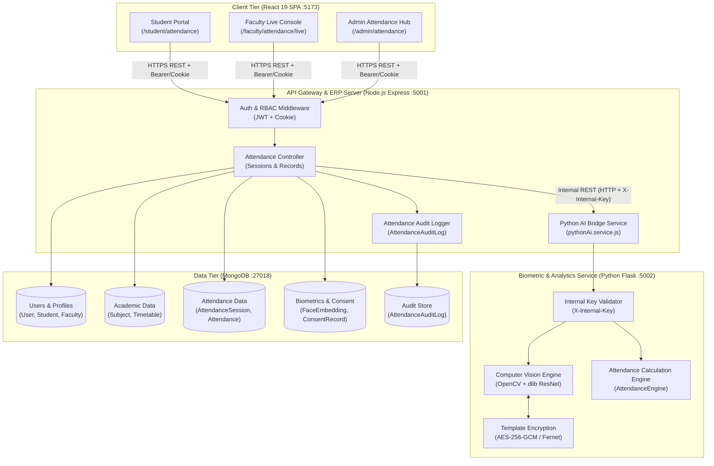
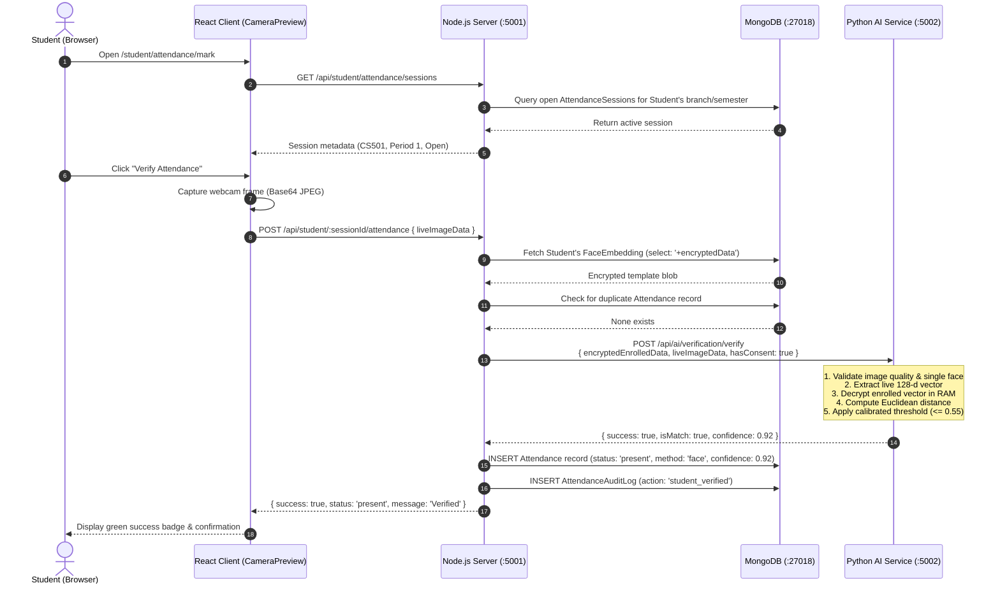

# Smart Attendance Architecture & Integration Guide

**System Name:** CampusSphere AI Smart Attendance Architecture  
**Document Version:** 1.0.0  
**Date:** November 1, 2026  
**Auditor:** Senior Software Architect & Technical Auditor  

---

## 1. System Architecture Overview

CampusSphere AI integrates computer-vision facial recognition and academic attendance tracking into a cohesive, secure, multi-tier architecture:

1. **Client Tier (React 19):** Single Page Application presenting dedicated views for Students, Faculty, and Administrators. Communicates strictly with the Node.js API Gateway via standard REST calls over HTTPS.
2. **Application Tier (Node.js / Express):** Acts as the central ERP Gateway, authentication provider, business logic orchestrator, and authorization enforcement point.
3. **AI Biometric Tier (Python 3.12 / Flask):** Isolated microservice dedicated to computer vision, photometric quality inspection, facial embedding generation (128-d vector), Euclidean matching, and mathematical attendance analytics.
4. **Data Tier (MongoDB / Mongoose):** Persistent operational data store holding academic catalogs, student rosters, session states, attendance records, immutable audit logs, and encrypted biometric templates.

---

## 2. Mermaid Architecture Diagram



---

## 3. Clear Responsibility Boundaries

To maintain high cohesion and prevent unnecessary technology sprawl, responsibilities are strictly divided:

### 3.1 Node.js / Express Backend Responsibilities
- **Authentication & Identity:** User authentication via bcrypt-hashed credentials, JWT issuance, token verification, and role-based access control (`student`, `faculty`, `admin`).
- **Academic State Management:** CRUD operations for subjects, timetable schedules, faculty course assignments, and student rosters.
- **Session Lifecycle:** Opening, activating, pausing, closing, and finalizing `AttendanceSession` instances.
- **Attendance Record Validation:** Enforcing duplicate prevention via unique compound index (`{ subject, student, date, period }`), verifying student enrollment eligibility for active sessions.
- **Manual Overrides & Corrections:** Controlled status changes with mandatory reason logging and faculty attribution.
- **Audit Logging:** Append-only logging of all attendance actions in `AttendanceAuditLog`.
- **Database Storage & Retrieval:** Direct interaction with MongoDB via Mongoose ODM.
- **Secure AI Orchestration:** Calling the Python service over an isolated internal network interface using mutual pre-shared secret headers (`X-Internal-Key`).

### 3.2 Python AI Service Responsibilities
- **Photometric Quality Inspection:** Analyzing live webcam frames for brightness, contrast, and Laplacian blur before biometric evaluation.
- **Face Detection:** Verifying that **exactly one** face exists in the frame using dlib HOG / OpenCV Haar cascade, rejecting frames with 0 or $>1$ face.
- **Biometric Template Generation:** Extracting 128-dimensional facial embedding vectors using dlib ResNet.
- **Biometric Verification (1:1):** Decrypting the enrolled template in memory, computing Euclidean distance and Cosine similarity against the live vector, and returning match status based on calibrated thresholds.
- **Template Cryptography:** Encrypting face vectors using Fernet AES-256-GCM before returning them to Node.js for database storage. Never storing raw face images on disk.
- **Attendance Analytics & Metrics:** Calculating percentage metrics, class attendance ratios, defaulter thresholds, and statistical reports.

---

## 4. End-to-End Data Flow: Student-Initiated Face Verification

The following sequence details how a student voluntarily verifies their attendance during an active class:



---

## 5. Security & Network Isolation

1. **Client Isolation:** The React client **never communicates directly with the Python AI service**. All traffic passes through the authenticated Node.js gateway.
2. **Internal API Authentication:** Calls from Node.js to Python include the header:
   ```http
   X-Internal-Key: <INTERNAL_API_KEY>
   ```
   Unauthenticated requests to `/api/internal/*` or `/api/ai/*` return `401 Unauthorized`.
3. **No Biometric Vector Exposure:** Face embedding vectors (128 floats) are encrypted with AES-256-GCM. The plaintext vector exists only in volatile RAM during the ~80ms verification computation and is never logged or exposed in HTTP responses.
4. **Graceful Fallbacks:** If the Python service is temporarily unreachable, Node.js catches the network timeout and provides graceful fallbacks or returns informative error messages without crashing the ERP.

