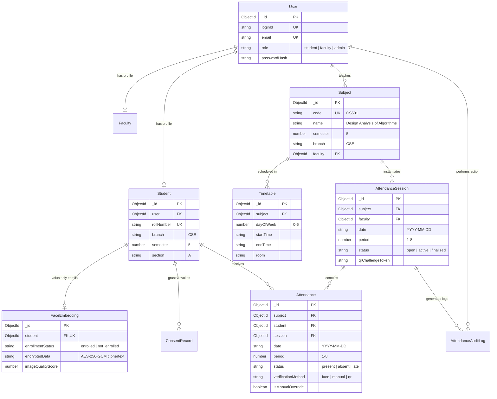

# Smart Attendance Data Integration Map & Entity Relationships

**System Name:** CampusSphere AI Smart Attendance Module  
**Audit Date:** November 1, 2026  
**Auditor:** Senior Software Architect & Technical Auditor  
**Scope:** MongoDB collection mapping, entity relationships, source-of-truth identification, and data consistency safeguards.

---

## 1. Source-of-Truth Mapping Table

| Required Attendance Information | Existing ERP Model / Source | Status in Repo | Integration Strategy |
|---|---|---|---|
| **User Identity & Login** | `server/models/User.js` | Active & Seeded | Primary identity provider (`_id`, `loginId`, `role`, `name`, `email`). |
| **Student Academic Profile** | `server/models/Student.js` | Active & Seeded | Source of truth for `rollNumber`, `branch`, `semester` (Sem 5), `section` ('A'). Links to `User._id`. |
| **Faculty Profile** | `server/models/Faculty.js` | Active & Seeded | Source of truth for `employeeId`, `department`, `designation`. Links to `User._id`. |
| **Academic Subject Catalog** | `server/models/Subject.js` | Active & Seeded | Source of truth for `code` (e.g. `CS501`), `name`, `credits`, `branch`, `semester`, and assigned `faculty` (ref `User`). |
| **Class Schedule / Timetable** | `server/models/Timetable.js` | Active & Seeded | Source of truth for weekly schedule (`dayOfWeek`, `startTime`, `endTime`, `room`, `subject`). |
| **Attendance Class Session** | `server/models/AttendanceSession.js` | Active & Seeded | Extends timetable slot into live instance (`sessionId`, `date`, `period`, `status`, `qrChallengeToken`). |
| **Per-Student Attendance Record** | `server/models/Attendance.js` | Active & Seeded | Atomic attendance instance (`subject`, `student`, `session`, `date`, `period`, `status`, `verificationMethod`). |
| **Biometric Profile & Template** | `server/models/FaceEmbedding.js` | Active & Seeded | Secure container for AES-256-GCM encrypted 128-d vector (`encryptedData`), consent status, and quality score. |
| **Consent Ledger** | `server/models/ConsentRecord.js` | Active & Seeded | Immutable audit log of student consent grants, version numbers, and revocation timestamps. |
| **Attendance Audit Log** | `server/models/AttendanceAuditLog.js` | Active & Seeded | Immutable audit log for session state transitions, status overrides, and administrative actions. |
| **System Settings** | `server/models/AttendanceSettings.js` | Active & Seeded | Singleton holding institutional rules (`minAttendancePercent: 75`, `defaultSessionDurationMinutes: 60`). |

---

## 2. Entity Relationship Diagram (ERD)

---

## 3. Academic Data Flow & Resolution Mechanics

### Connecting Scheduled Classes to Students
1. **Course Lookup:** When a faculty member opens their portal, the system queries:
   $$\text{Subjects where } \text{faculty} == \text{Faculty.user}$$
2. **Timetable Slot Selection:** Faculty selects today's slot from `Timetable` linked to that subject.
3. **Session Genesis:** An `AttendanceSession` is created with:
   $$\text{branch} = \text{Subject.branch}, \quad \text{semester} = \text{Subject.semester}, \quad \text{section} = \text{'A'}$$
4. **Student Roster Resolution:** All students eligible for attendance in this session are resolved dynamically by querying:
   $$\text{Student.find}(\{ \text{branch}: \text{Session.branch}, \text{semester}: \text{Session.semester}, \text{section}: \text{Session.section}, \text{status}: \text{'active'} \})$$
   This guarantees that session rosters are always based on actual academic enrollment, without hardcoded student arrays.

---

## 4. Potential Data Consistency Issues Discovered & Safeguards

### 4.1 Faculty Dashboard Stat Inconsistency (124 vs 8)
- **Investigation:** In `client/src/pages/FacultyDashboard/index.jsx:158`, the string `124` was hardcoded in static JSX (`
124
`), while `FacultyAttendance/index.jsx` displayed `8` (the actual number of enrolled Semester 5 CSE Section A students).
- **Remediation:** Replace static markup with dynamic query data from `GET /api/faculty/students` (`students.length`), binding both screens to the exact same database count.

### 4.2 Cross-Semester Timetable vs Student Semester
- **Investigation:** Previously, the timetable contained subjects from Semester 4 while students were promoted to Semester 5.
- **Remediation:** Executed `updateAllToSem5.js` migrating all subjects to Semester 5 (`CS501`–`CS514`), updating student records, and ensuring all timetable entries point exclusively to active 5th semester courses.

### 4.3 Database Name Collision in Dev Environment
- **Investigation:** In `server/config/db.js`, `mongodb-memory-server` creates a connection with `mongod.getUri()`, connecting mongoose to default database `"test"`. Some seed scripts referenced `"campus-erp"`.
- **Remediation:** Unify the MongoDB connection string to enforce the explicit database name `campus-erp` across `db.js`, seeds, and test runners.

