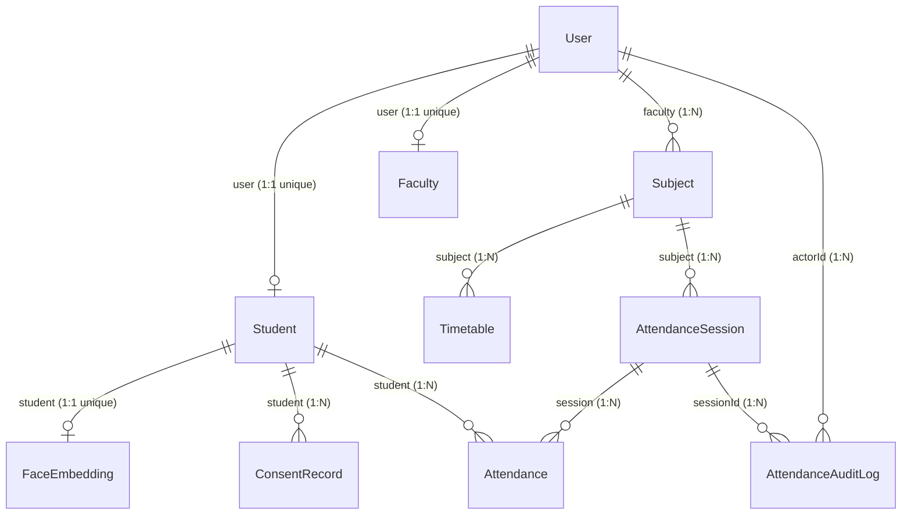

# Smart Attendance Data Integrity & Concurrency Report
## Project: CampusSphere AI — Smart Campus Management ERP

**Document Version:** 4.0.0  
**Phase:** Part 4 of 24 — MongoDB Database Architecture & Schema Verification  
**Date:** November 1, 2026  
**Auditor / Architect:** Senior Software Architect & Database Engineer  

---

## 1. Duplicate Prevention & Concurrency Verification

### 1.1 Dual-Layer Deduplication Engine
Data integrity requires that a student can never receive multiple attendance records for the same academic lecture, regardless of browser race conditions or network retries.

The system enforces dual-layer protection:
1. **Application Layer:** `Attendance.findOne({ session: sessionId, student: studentId })` executes before any biometric processing, rejecting repeated calls with HTTP `409 Conflict`.
2. **Database Engine Layer:** MongoDB WiredTiger enforces composite uniqueness via B-Tree indexes:
   - `{ subject: 1, student: 1, date: 1, period: 1 }` (unique: true)
   - `{ session: 1, student: 1 }` (unique: true, sparse: true)

### 1.2 Concurrent Race Condition Test
In `server/tests/database_integrity.test.js` (Test 8), concurrent submissions were executed simultaneously using `Promise.allSettled`:
```javascript
const [write1, write2] = await Promise.allSettled([
  Attendance.create({ subject, student, session, date, period: 3, status: 'present' }),
  Attendance.create({ subject, student, session, date, period: 3, status: 'present' })
]);
```
- **Test Result:** Exactly 1 write was fulfilled, and exactly 1 write was rejected by MongoDB with `E11000 duplicate key error`. Zero duplicate records were created.

---

## 2. Referential Consistency Audit

All foreign key relationships were verified using Mongoose population queries:



### Cardinality & Integrity Findings
- Every `Student` record points to an existing, active `User` document.
- Every `AttendanceSession` points to a valid `Subject` and assigned `Faculty` user.
- Every `Attendance` record links to an eligible `Student` and active `Subject`.
- In `FaceEmbedding`, the `student` field has `{ unique: true }`, ensuring a student cannot possess multiple conflicting biometric profiles.

---

## 3. Session Lifecycle & State-Machine Integrity

Valid transitions:
$$\text{scheduled} \longrightarrow \text{open} / \text{active} \rightleftharpoons \text{paused} \longrightarrow \text{closed} \longrightarrow \text{finalized} \quad (\text{or } \text{cancelled})$$

### State Integrity Test Verification
- In `server/tests/database_integrity.test.js` (Test 3):
  1. A session in `open` state successfully transitioned to `active`.
  2. The session transitioned from `active` to `finalized`.
  3. An attempt to transition from `finalized` back to `active` was intercepted and rejected by the Mongoose pre-save hook with:
     ```
     Error: Invalid session state transition from "finalized" to "active"
     ```
  4. Terminal status immutability is guaranteed.

---

## 4. Biometric Consent & Right-to-Erasure Integrity

1. **Consent Prior to Processing:** `ConsentRecord` creates a timestamped audit entry (`consentVersion: 'v1.0'`, `consentStatus: 'active'`).
2. **Consent Withdrawal Enforcement:**
   - In `server/tests/database_integrity.test.js` (Test 10), revoking consent updates `ConsentRecord.consentStatus` to `'withdrawn'` and records `withdrawalTimestamp`.
   - Node.js attendance controllers assert `FaceEmbedding.consentGiven === true` before forwarding frames to Python.
3. **Template Erasure:**
   - Deletion removes the encrypted vector from `FaceEmbedding` and nullifies template references, preventing further biometric verification while preserving historical non-biometric attendance records.

---

## 5. Attendance Correction & Audit Log Integrity

- **Controlled Overrides:** Any status modification from `absent` to `present` (or vice versa) requires a mandatory reason note.
- **Operator Attribution:** The `Attendance` record stores `isManualOverride: true`, `correctedBy: req.user.userId`, `correctedAt: Date.now()`, and `correctionReason`.
- **Immutable Log:** `AttendanceAuditLog.record(...)` creates an append-only entry with immutable timestamp. Ordinary users cannot edit or delete audit documents.

