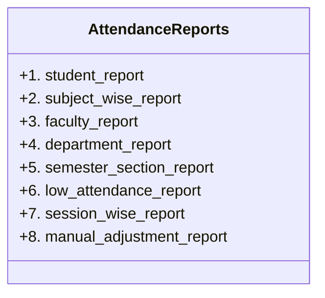

# CampusSphere AI — Attendance Report Generation & Export System
## Part 10: Practical Reports, RFC-4180 Compliance & Spreadsheet Security

---

## 1. Executive Summary

CampusSphere AI implements practical report generation and export capabilities tailored for institutional compliance, academic audit committees, university accreditors (e.g. NAAC, NBA), and daily classroom monitoring.

Exports are available in:
- **CSV:** Tabular data formatted according to RFC-4180 with spreadsheet formula injection protection.
- **JSON:** Standardized structured payloads for API integrations, preview dashboards, and reporting pipelines.

---

## 2. The 8 Practical Report Types



### 2.1 Report Type 1: Student Attendance Report (`student_report`)
- **Scope:** Individual student record across all enrolled subjects in an academic semester.
- **Access:** Student (own record only), Faculty (enrolled students), Admin (institution-wide).
- **Columns:** Subject Name, Code, Assigned Faculty, Classes Held, Classes Attended, Classes Missed, Percentage, Requirement, Status.
- **Executive Summary:** Student Name, Roll Number, Overall Percentage, Total Academic Units Held, Total Units Attended, Compliance Status.

### 2.2 Report Type 2: Subject-Wise Attendance Report (`subject_wise_report`)
- **Scope:** Complete student roster for a single academic course.
- **Access:** Faculty (authorized assigned courses), Admin.
- **Columns:** Roll Number, Student Name, Branch, Semester, Classes Held, Attended, Missed, Percentage, Requirement, Status.
- **Executive Summary:** Subject Name, Code, Faculty Instructor, Total Conducted Sessions, Total Units Held, Enrolled Students.

### 2.3 Report Type 3: Faculty Attendance Report (`faculty_report`)
- **Scope:** Teaching workload, classes scheduled, sessions conducted, and class averages.
- **Access:** Faculty (own record), Admin.
- **Columns:** Subject Name, Code, Semester, Sessions Conducted, Academic Units Held, Average Attendance, Status.
- **Executive Summary:** Faculty Name, Assigned Students, Scheduled Classes, Conducted Sessions, Class Average, At-Risk Students.

### 2.4 Report Type 4: Department Attendance Report (`department_report`)
- **Scope:** Institutional breakdown across academic departments (CSE, IT, ECE, MECH, etc.).
- **Access:** Admin only.
- **Columns:** Department Name, Active Students, Finalized Sessions, Total Units Held, Overall Attendance, Requirement, Status.
- **Executive Summary:** Total Departments Analyzed, Minimum Required Policy.

### 2.5 Report Type 5: Semester / Section Report (`semester_section_report`)
- **Scope:** Cohort-level analysis (e.g. `CSE Semester 4 Section A`).
- **Access:** Faculty (assigned sections), Admin.
- **Columns:** Roll Number, Student Name, Class/Section, Units Held, Units Attended, Units Missed, Percentage, Deficit Units, Status.
- **Executive Summary:** Cohort Identifier, Enrolled Students, Conducted Sessions, Section Average.

### 2.6 Report Type 6: Low Attendance Student Report (`low_attendance_report`)
- **Scope:** Academic risk register containing all students falling below the institutional threshold.
- **Access:** Faculty (assigned students), Admin.
- **Columns:** Roll Number, Student Name, Department, Semester, Section, Units Held, Attended, Missed, Percentage, Threshold, Deficit Units, Risk Level.
- **Executive Summary:** Total Students at Risk, Configured Debarment Threshold, Status.

### 2.7 Report Type 7: Session-Wise Report (`session_wise_report`)
- **Scope:** Complete attendance ledger for a single class session.
- **Access:** Faculty (session creator), Admin.
- **Columns:** Roll Number, Student Name, Cohort, Attendance Status, Verification Method, Face Confidence, Marked At (IST).
- **Executive Summary:** Subject, Faculty, Date, Period, Academic Units, Present Count, Status.

### 2.8 Report Type 8: Manual Adjustment Audit Report (`manual_adjustment_report`)
- **Scope:** Complete transparency ledger of manual attendance overrides.
- **Access:** Faculty (assigned courses), Admin.
- **Columns:** Timestamp (IST), Roll Number, Student Name, Subject, Session Date, Period, Previous Status, Updated Status, Authorized Actor, Mandatory Reason.
- **Executive Summary:** Total Audit Corrections, Integrity Policy.

---

## 3. Spreadsheet Security & Formula Injection Defense

### 3.1 Vulnerability Context
When spreadsheets (Microsoft Excel, LibreOffice Calc, Apple Numbers, Google Sheets) open CSV files, any cell starting with specific characters can execute arbitrary operating system commands, launch external DDE links, or exfiltrate sensitive data via `=IMPORTXML()`.

Trigger characters include:
- `=` (Equal sign — formula start)
- `+` (Plus sign — formula start)
- `-` (Minus sign — formula start)
- `@` (At sign — formula / lookup trigger)
- `\t` (Tab character)
- `\r` (Carriage return)

### 3.2 Implemented Sanitization Logic
In `server/services/attendanceExport.service.js`:
```javascript
sanitizeCsvCell(value) {
  if (value === null || value === undefined) return '';
  let str = String(value);

  // Formula Injection Defense
  if (/^[=+\-@\t\r]/.test(str)) {
    str = `'${str}`;
  }

  // RFC-4180 Quoting
  if (/[",\n\r]/.test(str)) {
    str = `"${str.replace(/"/g, '""')}"`;
  }

  return str;
}
```

### 3.3 Test Verification
Tests confirm that malicious payloads such as `=SUM(A1:A10)`, `+cmd|"/C calc"!A0`, and `@IMPORTXML(...)` are neutralized by prepending `'`, rendering them as safe text literals inside spreadsheet applications.

---

## 4. Role-Based Access Control (RBAC) Matrix

| Report Type | Student | Faculty | Admin |
|---|---|---|---|
| `student_report` | Own Profile Only | Enrolled Students | Institution-Wide |
| `subject_wise_report` | ✗ Forbidden | Assigned Subjects Only | All Subjects |
| `faculty_report` | ✗ Forbidden | Own Workload Only | All Faculty |
| `department_report` | ✗ Forbidden | ✗ Forbidden | All Departments |
| `semester_section_report` | ✗ Forbidden | Assigned Cohorts Only | All Cohorts |
| `low_attendance_report` | ✗ Forbidden | Assigned Cohorts Only | Institution-Wide |
| `session_wise_report` | ✗ Forbidden | Own Sessions Only | All Sessions |
| `manual_adjustment_report`| ✗ Forbidden | Own Sessions Only | Institution-Wide |

