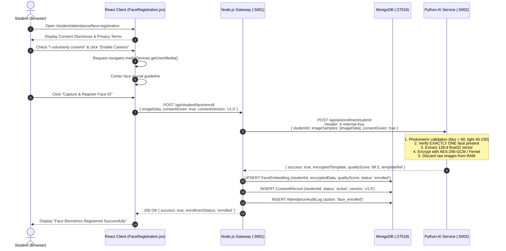
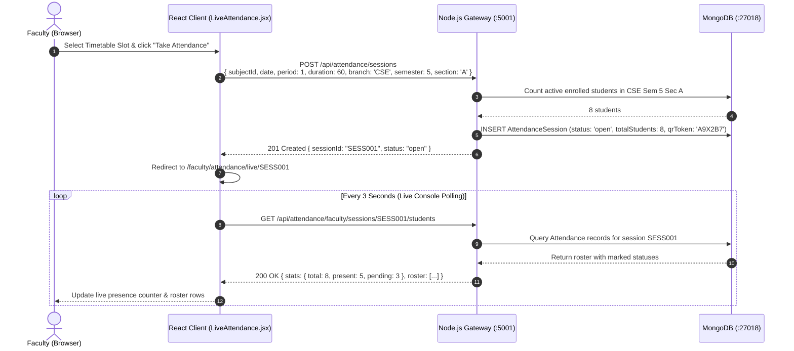
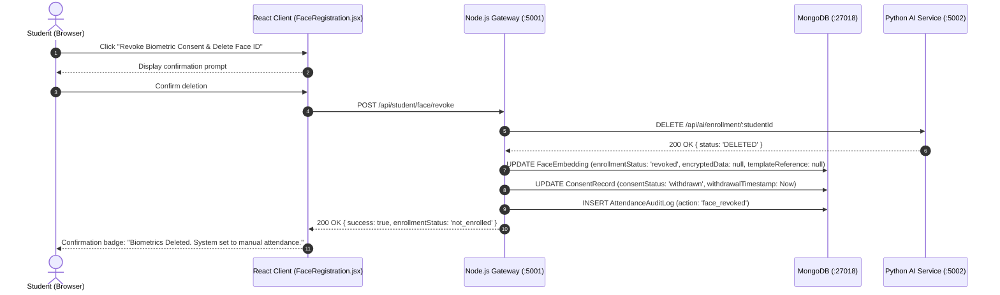

# Smart Attendance Sequence Diagrams & Architectural Workflows
## Project: CampusSphere AI — Smart Campus Management Platform

**Document Version:** 3.0.0  
**Phase:** Part 3 of 24 — Complete System Architecture & Technical Design  
**Date:** November 1, 2026  
**Auditor / Architect:** Senior Software Architect & Technical Lead  

---

## 1. Student Attendance 1:1 Biometric Verification

```mermaid
sequenceDiagram
    autonumber
    actor Student as Student (Browser)
    participant Client as React Client (CameraPreview)
    participant Node as Node.js Gateway (:5001)
    participant Mongo as MongoDB (:27018)
    participant Python as Python AI Service (:5002)

    Student->>Client: Open /student/attendance/mark
    Client->>Node: GET /api/attendance/student/active-sessions
    Node->>Mongo: Find AttendanceSession where branch/sem/sec match & status='open'
    Mongo-->>Node: Return active session metadata (CS501, Period 1)
    Node-->>Client: 200 OK [Session Details]

    Student->>Client: Click "Verify Attendance"
    Client->>Client: Capture webcam frame (Base64 JPEG, max 640x480)
    Client->>Node: POST /api/attendance/student/:sessionId/attendance<br/>{ liveImageData: "data:image/jpeg;base64,..." }

    Note over Node: Validate student eligibility & query duplicate
    Node->>Mongo: Attendance.findOne({ session: sessionId, student: studentId })
    Mongo-->>Node: null (No duplicate exists)

    Node->>Mongo: FaceEmbedding.findOne({ student: studentId }).select('+encryptedData')
    Mongo-->>Node: Encrypted enrolled vector blob

    Node->>Python: POST /api/ai/verification/verify<br/>Header: X-Internal-Key<br/>{ encryptedEnrolledData, liveImageData, hasConsent: true }
    
    Note over Python: 1. Validate brightness, blur, contrast<br/>2. Detect single face (dlib HOG)<br/>3. Extract live 128-d vector (dlib ResNet)<br/>4. Decrypt enrolled vector in RAM<br/>5. Calculate Euclidean distance (d <= 0.55)
    Python-->>Node: { success: true, isMatch: true, confidence: 0.94, distance: 0.36 }

    Node->>Mongo: INSERT Attendance record (status: 'present', method: 'face', confidence: 0.94)
    Node->>Mongo: INSERT AttendanceAuditLog (action: 'student_verified')
    Node-->>Client: 200 OK { success: true, status: 'present', confidence: 0.94 }
    Client-->>Student: Display green success checkmark & confirmation badge
```

---

## 2. Voluntary Biometric Enrollment Workflow



---

## 3. Faculty Session Creation & Live Attendance Monitoring



---

## 4. Controlled Faculty Manual Override Workflow

```mermaid
sequenceDiagram
    autonumber
    actor Faculty as Faculty (Browser)
    participant Client as React Client (LiveAttendance.jsx)
    participant Node as Node.js Gateway (:5001)
    participant Mongo as MongoDB (:27018)

    Faculty->>Client: Click on Student 20240002 (Camera Error in Classroom)
    Client-->>Faculty: Open Override Modal (Status: Present, Mandatory Reason Input)
    Faculty->>Client: Enter reason: "Camera device fault; presence confirmed verbally"
    Faculty->>Client: Confirm Override
    
    Client->>Node: PATCH /api/attendance/faculty/records/ATT002<br/>{ targetStatus: 'present', reason: 'Camera device fault...' }
    
    Note over Node: Verify Faculty owns session or has admin role
    Node->>Mongo: UPDATE Attendance (status: 'present', isManualOverride: true, correctedBy: facultyId, correctionReason: reason)
    Node->>Mongo: INSERT AttendanceAuditLog (action: 'manual_override', operator: facultyId, targetStudent: studentId, reason: reason)
    Node-->>Client: 200 OK { success: true, message: 'Status overridden' }
    Client-->>Faculty: Roster row updates to "Present (Manual Override)"
```

---

## 5. Biometric Consent Withdrawal & Template Purge



---

## 6. Failure & Recovery Architecture Flow

```mermaid
sequenceDiagram
    autonumber
    actor Student as Student (Browser)
    participant Client as React Client
    participant Node as Node.js Gateway (:5001)
    participant Python as Python AI Service (:5002)

    Student->>Client: Submit verification frame
    Client->>Node: POST /api/attendance/student/:sessionId/attendance

    alt Python AI Service Unreachable (Timeout > 8s)
        Node->xPython: POST /api/ai/verification/verify (Connection Refused / Timeout)
        Note over Node: Catch AbortSignal error; log alert; DO NOT record false attendance
        Node-->>Client: 503 Service Unavailable<br/>{ success: false, status: 'AI_SERVICE_UNAVAILABLE', message: 'Biometric engine temporarily unavailable. Use QR code or faculty sign-in.' }
        Client-->>Student: Display actionable error + "Switch to QR / Faculty Check-in" button
    else Duplicate Attendance Attempt (Double-Click Race)
        Node->>Node: Check database compound unique index
        Node-->>Client: 409 Conflict<br/>{ success: false, status: 'DUPLICATE_ATTENDANCE', message: 'Attendance already recorded.' }
        Client-->>Student: Display "Already Marked Present" checkmark
    end
```

