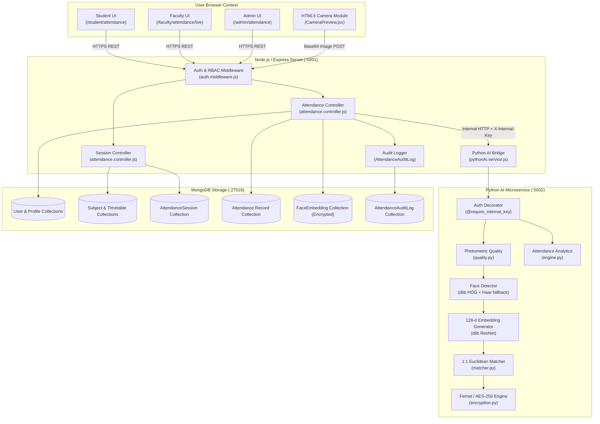

# Smart Attendance System Architecture & Technical Specification
## Project: CampusSphere AI — Smart Campus Management Platform

**Document Version:** 3.0.0  
**Phase:** Part 3 of 24 — Complete System Architecture & Technical Design  
**Date:** November 1, 2026  
**Auditor / Architect:** Senior Software Architect, Full-Stack Engineer & Python Computer-Vision Engineer  

---

## 1. Primary Architecture Overview

The **CampusSphere AI Smart Attendance System** is an integrated, enterprise-grade, multi-tier module engineered directly within the existing CampusSphere higher-education ERP. The system enables **voluntary, student-initiated, one-to-one (1:1) facial biometric verification**, automated class roster tracking, real-time live attendance monitoring, and administrative compliance reporting without introducing covert classroom surveillance or replacing existing ERP infrastructure.

### Architectural Philosophy
1. **Preservation of Core ERP:** Reuse established user authentication (`User`), academic student rosters (`Student`), faculty course assignments (`Faculty`, `Subject`), and weekly timetable schedules (`Timetable`).
2. **Modular Monolith Gateway:** The Node.js/Express backend serves as the single authoritative API Gateway and business logic orchestrator.
3. **Decoupled Python AI Service:** An isolated Python 3.12 microservice performs CPU-optimized computer vision (OpenCV, dlib ResNet-128d), image quality checks, template encryption, and mathematical analytics.
4. **Zero Raw Image Retention:** Photographs are never written to disk or database. 128-dimensional mathematical feature vectors are encrypted with AES-256-GCM / Fernet before storage.
5. **Absolute Deduplication:** Database-enforced composite unique constraint `{ subject, student, date, period }` guarantees atomic deduplication.
6. **Non-Biometric Parity:** Faculty-controlled manual overrides with mandatory audit justification notes and rotating QR challenge codes guarantee full accessibility for students who withhold biometric consent or encounter technical hurdles.

---

## 2. Technology Stack & Component Responsibilities

```
┌────────────────────────────────────────────────────────────────────────┐
│                        CLIENT PRESENTATION TIER                        │
│                   React 19 SPA (Vite 8, Port 5173)                     │
│  - Student Portal: Attendance Dashboard, Mark Attendance, Camera UI   │
│  - Faculty Portal: Live Attendance Console, Timetable Session Launcher│
│  - Admin Portal: Governance Hub, Policy Settings, Audit Inspector     │
│  - Shared UI: Collapsible Icon Sidebar (64px/240px), Enterprise Theme │
└───────────────────────────────────┬────────────────────────────────────┘
                                    │ HTTPS REST + JWT / Cookie
                                    ▼
┌────────────────────────────────────────────────────────────────────────┐
│                    APPLICATION GATEWAY & BUSINESS TIER                 │
│              Node.js 20+ Express Modular Monolith (Port 5001)          │
│  - Authentication & Authorization: JWT Verification, RBAC Middleware   │
│  - Session Orchestration: Open, Active, Paused, Closed, Finalized     │
│  - Academic Integration: Resolves Subjects, Timetables, Rosters       │
│  - Record Integrity: Deduplication, Atomic Persistence, Fallbacks     │
│  - Audit Logging: Append-only event history (AttendanceAuditLog)       │
│  - Service Bridge: HTTP Client to Python Service (pythonAi.service.js)│
└───────────────────────┬──────────────────────────────┬─────────────────┘
                        │                              │
         Mongoose / TCP │                              │ Internal HTTP REST
         Port 27018     │                              │ X-Internal-Key, Port 5002
                        ▼                              ▼
┌────────────────────────────────┐  ┌────────────────────────────────────┐
│           DATA TIER            │  │        BIOMETRIC & AI TIER         │
│     MongoDB (WiredTiger 7.0)   │  │   Python 3.12 Flask Microservice   │
│  - User, Student, Faculty      │  │  - Photometric Quality Engine      │
│  - Subject, Timetable          │  │  - Face Detection (dlib HOG + Haar)│
│  - AttendanceSession           │  │  - 128-d ResNet Embedding Model    │
│  - Attendance (Records)        │  │  - 1:1 Euclidean Distance Matcher  │
│  - FaceEmbedding (Encrypted)   │  │  - AES-256-GCM Template Encryption │
│  - ConsentRecord, AuditLog     │  │  - Attendance Calculation Engine   │
└────────────────────────────────┘  └────────────────────────────────────┘
```

### Detailed Responsibility Boundaries

| Responsibility | Frontend (React 19) | Backend (Node.js) | AI Service (Python 3.12) | Database (MongoDB) |
|---|---|---|---|---|
| **User Identity & Role Verification** | Displays UI based on role | **Authoritative Validator** (JWT HS256) | Validates internal caller key | Stores bcrypt hashes & roles |
| **Camera & Video Frame Capture** | Accesses MediaDevices API | Dispatches payload | None (No camera access) | None |
| **Frame Quality & Face Detection** | None (Untrusted client) | Passes Base64 payload | **Authoritative Validator** (OpenCV/dlib) | None |
| **1:1 Face Verification** | None (Never trusted) | Coordinates request | **Extracts & Compares Vectors** | None |
| **Attendance Record Decision** | None (Displays result) | **Authoritative Decider** | Computes distance metric | Enforces uniqueness constraint |
| **Session Lifecycle State** | Visualizes timers & state | **Enforces state machine** | None | Persists session status |
| **Biometric Encryption & Storage** | None | Dispatches ciphertext | **Encrypts via Fernet/AES-GCM** | Persists encrypted template blob |
| **Audit Logging** | None | **Emits immutable logs** | Logs technical verification events | Stores append-only audit trail |

---

## 3. High-Level Component Diagram



---

## 4. Trust Boundaries & Security Enclaves

1. **Untrusted Zone (Public Internet / Campus Network):**
   - The user browser and webcam hardware.
   - All input from client is treated as completely untrusted. The backend never accepts client-provided timestamps, match results, or identity claims.
2. **ERP Application Gateway (Demilitarized Zone):**
   - Node.js Express server listening on port `5001`.
   - Terminates TLS/HTTPS, validates JWT tokens, enforces rate limits, extracts `req.user.userId`, and checks session eligibility.
3. **Internal Biometric Enclave (Private Isolated Subnet):**
   - Python AI service listening strictly on `127.0.0.1:5002` (or an internal VPC network).
   - Never directly exposed to the public internet.
   - Accessible only by Node.js using pre-shared internal secret headers (`X-Internal-Key`).
4. **Data at Rest Enclave:**
   - MongoDB on port `27018`.
   - Access restricted to Node.js backend.
   - Sensitive fields (`encryptedData`, `passwordHash`) protected by schema-level exclusion (`select: false`).

---

## 5. Architectural Failure Handling & Resilience

| Failure Scenario | Immediate System Reaction | User Experience | Recovery Mechanism |
|---|---|---|---|
| **Python AI Service Crash** | Node.js `pythonAi.service.js` catches connection timeout ($8000\text{ms}$) via `AbortSignal`. | Student is notified: *"Biometric service temporarily unavailable. Please request manual check-in from your professor."* | Node.js activates manual override fallback; Python process is auto-restarted via PM2 or systemd supervisor. |
| **Client Camera Hardware Failure** | `CameraPreview.jsx` catches `NotAllowedError` / `NotFoundError`. | Student sees: *"Camera access blocked. Click here to use rotating QR code or faculty sign-in."* | Non-biometric manual attendance path is presented immediately. |
| **MongoDB Transient Disconnection** | Mongoose reconnect buffer queues write operations for up to 30 seconds. | If database is unreachable past buffer timeout, HTTP `503 Service Unavailable` is returned. | Server retries connection automatically; atomic compound index prevents duplicate writes upon reconnection. |
| **Simultaneous Multi-Tab Attendance Submission** | First request succeeds; second concurrent request hits compound unique index `{ subject, student, date, period }`. | First tab shows green success checkmark; second tab receives `409 Conflict: Attendance already recorded`. | Handled gracefully without error screen; student attendance remains intact. |
| **Faculty Browser Tab Closure During Active Session** | Session state persists in MongoDB (`AttendanceSession.status: 'open'`). | Students continue marking attendance uninterrupted. | Faculty re-opens `/faculty/attendance/live/:sessionId`; live roster and timer hydrate immediately from database. |

